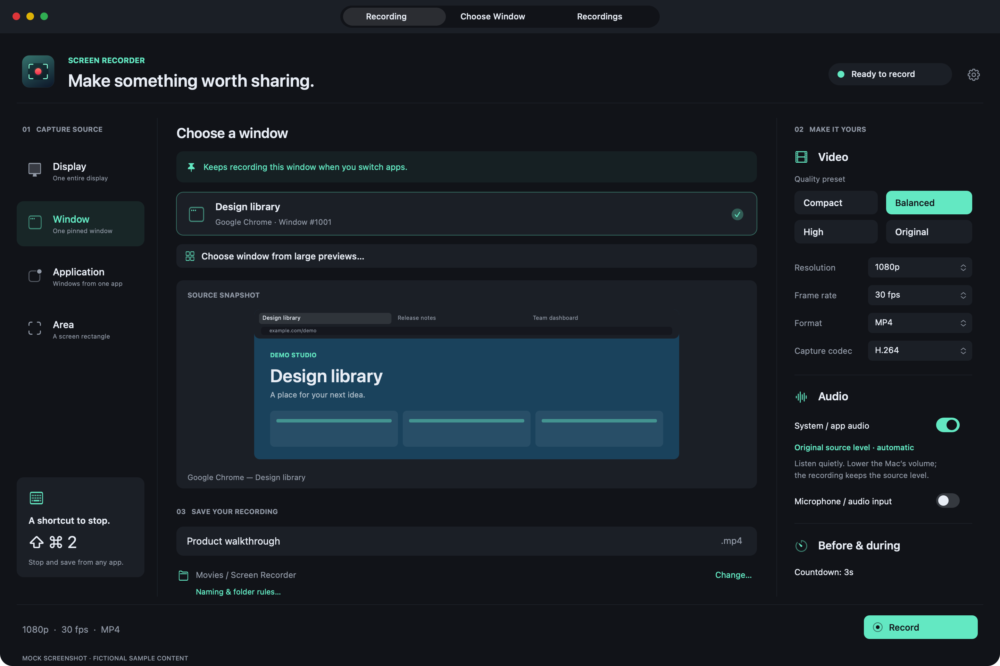
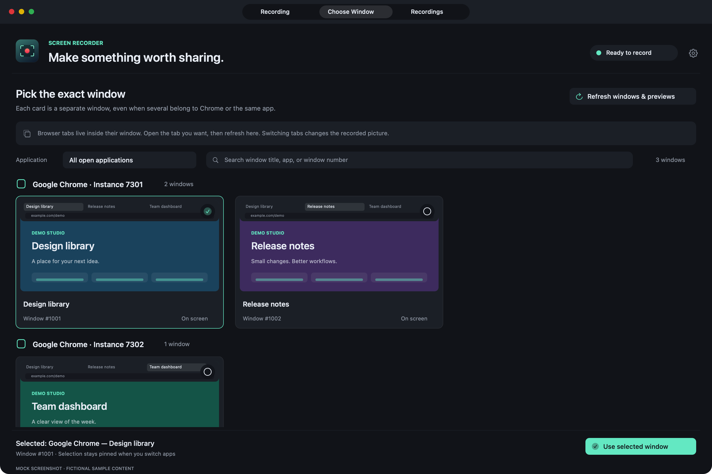
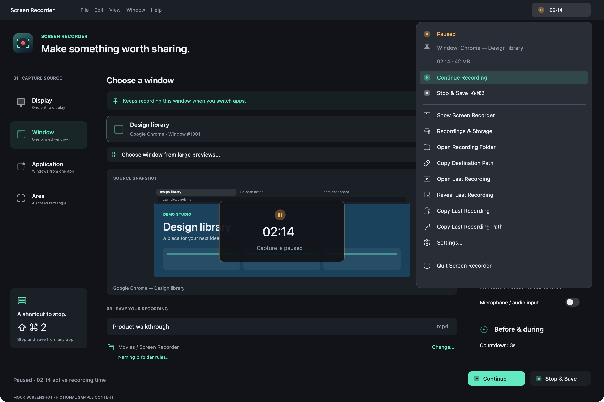

# Screen Recorder for macOS

Record a display, one window, an application, or just the area you choose — with application audio, a microphone, or no sound. Pause and continue from the menu bar, then save your recording on your Mac.

**Coming soon.** This is the public documentation preview. A public app download is not available yet. Download instructions, release notes, and pricing or purchase information will be announced here when the app is published. See [release status](RELEASES.md).

Designed for **macOS 15 or later**, on Apple silicon and Intel Macs. Final compatibility details will accompany the first public release.

## Explore the app

- Choose one window from a separate tab with large previews, app groups, and search.
- Keep recording a selected Firefox or Chrome window while you work in another app.
- Record original-level application audio while your Mac’s speakers are quiet or muted.
- Add a microphone, record without sound, or combine application audio and microphone input.
- Set a countdown, video resolution, frame rate, cursor options, and an automatic stop time.
- Pause, continue, and stop from the menu bar.
- Keep the default filename and folder, or add prefixes, suffixes, app names, and date-based subfolders.
- Save as MP4 (default) or MOV using built-in macOS recording, with no extra software.
- Browse recordings in a separate tab with size totals, creation/modification times, search, and sorting.

## Take a look

These are **mock screenshots with fictional sample content**. No personal desktop, private browser tabs, or real recordings are shown. Appearance can vary with macOS and the released version.

**Recording setup**

**Pick the exact window**

**Menu bar controls**

**Naming and folder rules**

**Your recordings and storage**

## User guide

| Guide | What it covers |
| --- | --- |
| [Get started](guides/getting-started.md) | Availability, installation, permissions, and your first recording |
| [Choose what to record](guides/capture-sources.md) | Displays, windows, apps, areas, browser tabs, and multiple windows |
| [Set up audio](guides/audio.md) | Application sound, microphones, quiet listening, and silent recording |
| [Recording options and files](guides/settings-and-files.md) | Quality, countdown, pause, shortcuts, formats, and saving |
| [Naming, folders, and recordings](guides/organizing-recordings.md) | Optional naming rules, app/date folders, file details, sorting, and storage totals |
| [Troubleshooting and FAQ](guides/troubleshooting.md) | Missing windows, black previews, audio, saving, and permissions |
| [Privacy](PRIVACY.md) | Permissions, local files, preview images, and public support |
| [Release status](RELEASES.md) | Public availability and what to check before downloading |
| [Get help](SUPPORT.md) | Ask a question, report a problem, or request a feature |

The guides describe the current preview. Features and system requirements may change before publication. This repository contains end-user documentation and mock images; app downloads will be announced separately.
