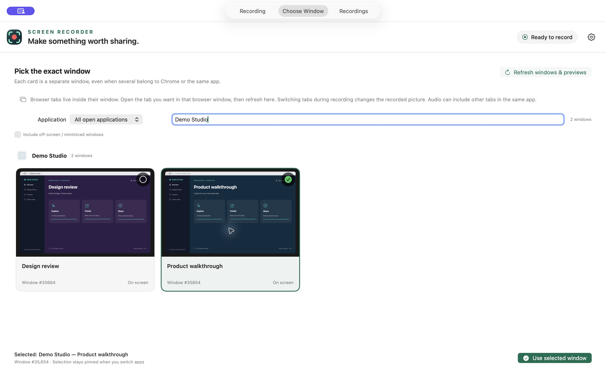

# Choose what to record

[← All guides](../README.md#user-guide)

| Mode | What it records | When you switch to another app |
| --- | --- | --- |
| **Display** | Everything visible on the selected display | The other app appears in the recording if visible there |
| **Window** | One specific window | The selected window stays the source, even when covered |
| **Application** | The selected running app’s windows on one chosen display | Other apps are excluded from the picture |
| **Area** | A fixed rectangle on a display | Whatever covers that rectangle appears in the recording |

## Choose one window from large previews

1. Click **Window**, or open the **Choose Window** tab.
2. Use the **Application** filter or search by window title, app name, or window number. Enable **Include off-screen / minimized windows** if you need a window that is not currently on screen.
3. Select the preview of the exact window you want. Check its title, window number, and selection marker.
4. Click **Use selected window** to return to recording settings.
5. Confirm the source and start recording.

The gallery groups windows by their application. Each window has a separate card, including windows with the same title. Separate running instances with the same app name have different instance labels and groups. The instance number is just an identifier to help tell them apart.

Your search, app filter, and selected window stay selected when you switch between the chooser and recording tabs. **Refresh windows & previews** updates titles and still previews. Previews are cached so scrolling away and back does not start them over; an existing image can remain visible while it updates. A **Last preview** badge means the image could not be updated yet. The list also refreshes when you return to the app or applications open or quit. If a chosen window closes, refresh and select another explicitly; the app does not silently record a different window.

## Multiple Chrome or Firefox windows and tabs

Each browser **window** is a separate recording source. A browser **tab** belongs to its window; inactive tabs are not listed as independent capture windows.

- Open the tab you want in the intended browser window, then refresh the gallery.
- The preview shows that window’s currently visible tab and browser controls.
- Switching to a different browser window does not change the selected recording source.
- Switching tabs inside the selected window changes what the recording shows.
- To record a tab independently, move it into its own browser window first.

For example, select the Firefox window playing a video, start recording, and then work in Chrome. The picture remains pinned to that Firefox window. Keep Firefox open and its video playing. A browser may pause or reduce playback when minimized or hidden, and protected video may not be capturable.

**Sound has a wider scope than one browser tab.** Window and Application capture can include audio from other tabs or windows in that application. Pause or mute unwanted playback in the source app. See [audio setup](audio.md).

## Record an application

Choose **Application**, select the running app or instance, and choose the display containing its windows. This is useful for an app with several windows, sheets, or dialogs. Enable **Include child windows** if needed.

Application capture is tied to the chosen display. Other apps are excluded, and unused space appears black. It does not combine all monitors into a single picture.

## Record an area

Choose **Area**, select a display, and click **Drag to select an area…**. Drag the rectangle you want; press Escape to cancel. You can choose a different area before starting.

The rectangle stays in a fixed location on that display. It does not follow a window that you move. If Chrome or a notification covers the rectangle, it becomes part of the recording.

## Displays, hidden windows, and previews

Display mode records one selected display. Window mode can keep the same selected window when you move it between displays. Application and Area modes remain tied to their chosen display.

The default gallery shows on-screen windows, including covered ones. Enable **Include off-screen / minimized windows** to include the others. An off-screen window may show **Restore window for preview**, or its last cached image with a **Last preview** badge. Restore it and click **Refresh windows & previews** to update it.

If a window returns no picture or an all-black image, the gallery retries once, then shows **No preview image** or keeps a labeled last good preview. That message can mean the window is hidden, not providing frames, or showing protected content. The app does not switch to capturing your desktop as a fallback. A missing preview is not a guarantee that recording will work; make a short test. DRM or other protected content may remain unavailable.

Source selection is locked during recording, pause, and saving. Finish the recording before choosing another source.
