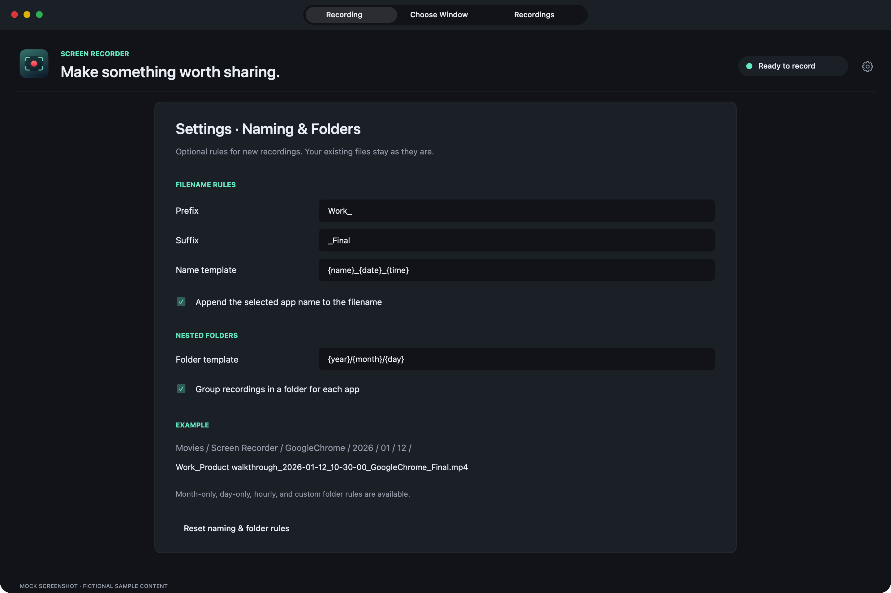
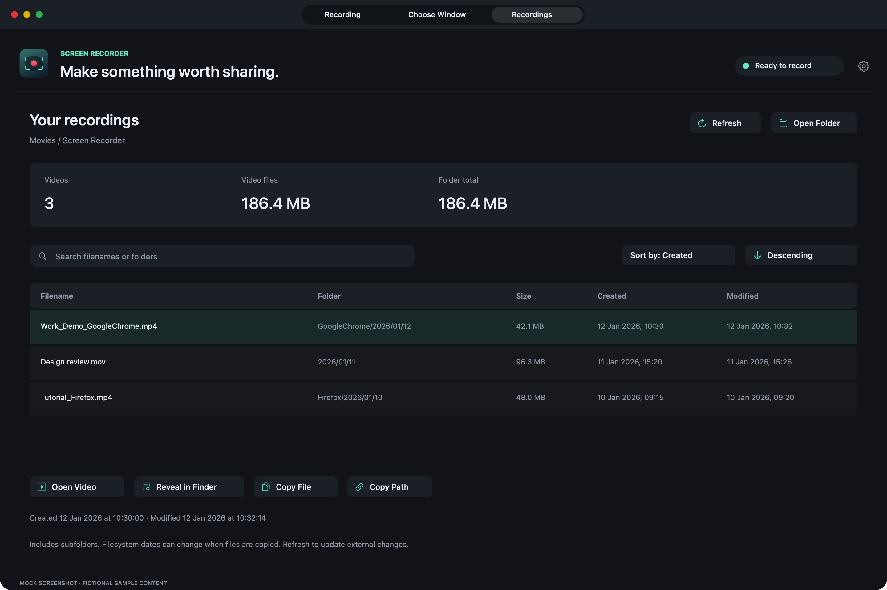

# Naming, folders, and your recordings

[← All guides](../README.md#user-guide) · [Recording options and files](settings-and-files.md)

## Keep the defaults, or choose your own rules

By default, Screen Recorder keeps the existing **Recording YYYY-MM-DD HH-mm-ss** naming style and saves directly in **Movies → Screen Recorder**, or the folder you have already chosen. MP4 remains the default for a new installation. Your saved preferences are retained when updating.

Open **Settings → Naming & Folders**, or **Naming & folder rules…** below the filename in the Recording tab. All rules are optional and apply only to future recordings. They never rename or reorganize existing files. Choose **Reset naming & folder rules** to return to using the filename field and saving directly in your selected base folder.

## Prefixes, suffixes, and filename templates

**Prefix** and **Suffix** add literal text before or after your filename. Add any separator you want, such as `Work_` or `_Final`.

The default **Name template** is `{name}`, which uses the filename you entered in the Recording tab. Choose an example or type a custom template. The format’s extension is added automatically.

| Token | Meaning | Example |
| --- | --- | --- |
| `{name}` | Filename entered in the Recording tab, without its video extension | Product walkthrough |
| `{app}` | Selected source’s application name, without spaces or punctuation | GoogleChrome |
| `{mode}` | Capture mode | Window |
| `{date}` | Local date when you press Record | 2026-01-12 |
| `{time}` | Local 24-hour time when you press Record | 10-30-00 |
| `{year}` | Four-digit year | 2026 |
| `{month}` | Two-digit month | 01 |
| `{day}` | Two-digit day of the month | 12 |
| `{hour}` | Two-digit hour, 00–23 | 10 |
| `{minute}` | Two-digit minute | 30 |
| `{second}` | Two-digit second | 00 |

For example, prefix `Work_`, template `{name}`, the app-name switch enabled, and suffix `_Final` can produce **Work_Product walkthrough_GoogleChrome_Final.mp4**. Another template, `{app}_{date}_{time}`, can produce **GoogleChrome_2026-01-12_10-30-00.mp4**.

Tokens are expanded in the filename and folder templates. Prefixes and suffixes are literal text. The example path updates as you edit; the date/time is fixed for the session when you press Record, before the countdown. Unknown tokens or invalid names show an error and prevent recording until corrected. Existing filenames receive a number instead of being overwritten.

## Date, time, and application folders

Leave **Folder template** empty to save directly in your chosen folder. Use `/` between levels, with up to eight nested levels including optional app grouping.

| Folder template | Example subfolder |
| --- | --- |
| `{year}/{month}/{day}` | 2026/01/12 |
| `{year}/{month}` | 2026/01 |
| `{month}` | 01 |
| `{day}` | 12 |
| `{date}/{hour}` | 2026-01-12/10 |
| `{app}/{year}/{month}` | GoogleChrome/2026/01 |

A month-only folder combines that month across years. A day-only folder combines the same day number across months and years. Include the year and month if you want each date kept separately.

**Group recordings in a folder for each app** adds the selected app as the first folder level. With `{year}/{month}/{day}`, a Chrome recording could go to **Movies / Screen Recorder / GoogleChrome / 2026 / 01 / 12**. Use either the grouping switch or `{app}` in the template unless you want the app repeated at two levels.

App naming uses the application that owns the selected window, or the application selected in Application mode. It stays with that source when you switch focus to another app. It identifies the app, not a browser tab, account, or individual window instance. Display and Area modes use **Display** and **Area**, because they do not capture only one app. A separate browser tab’s title is not used in filenames automatically.

Generated folders stay under your chosen base folder. Rules cannot contain parent-directory traversal or use a nested symbolic link to escape that folder. Keep the destination drive connected until saving finishes.

## Recordings tab and storage statistics

Open the **Recordings** tab, or choose **Recordings & Storage** in the menu bar. It lists MP4 and MOV recordings in your current base folder and its subfolders. Existing WebM and MKV files remain visible too; creating new WebM/MKV exports is disabled. It reads local file details in the background and does not upload or automatically play videos.

- **Videos:** number of listed video files.
- **Video files:** combined logical size of the listed videos.
- **Folder total:** combined logical size of visible regular files, including non-video files and temporary recordings. This is not the exact disk allocation or the size of other save folders or drives.
- **Created** and **Modified:** filesystem timestamps. Selecting a file shows the full date/time, including seconds, and exact byte count. These dates may change when files are copied or edited; they are not a guaranteed original recording start or end time.
- **Sort by:** Name, Folder, Size, Created, or Modified, with Ascending/Descending order.
- **Search:** filter by filename or subfolder. Summary totals still cover the whole scanned folder.
- **Open Video**, **Reveal in Finder**, **Copy File**, and **Copy Path** act on the selected file. Double-clicking a row opens it in its default player; right-clicking offers the same actions.

The scan skips hidden files, application packages, symbolic links, and unfinished recording sections in the video list. Temporary sections still count toward Folder total. Unreadable items produce a warning and totals may be incomplete. A missing save folder shows an empty list until it is created.

The list refreshes when opened, when your save folder changes, and after a recording is saved. Use **Refresh** for files changed in Finder or for an updated size during recording. The Recordings tab remains available while recording; use the menu bar to pause or stop.
